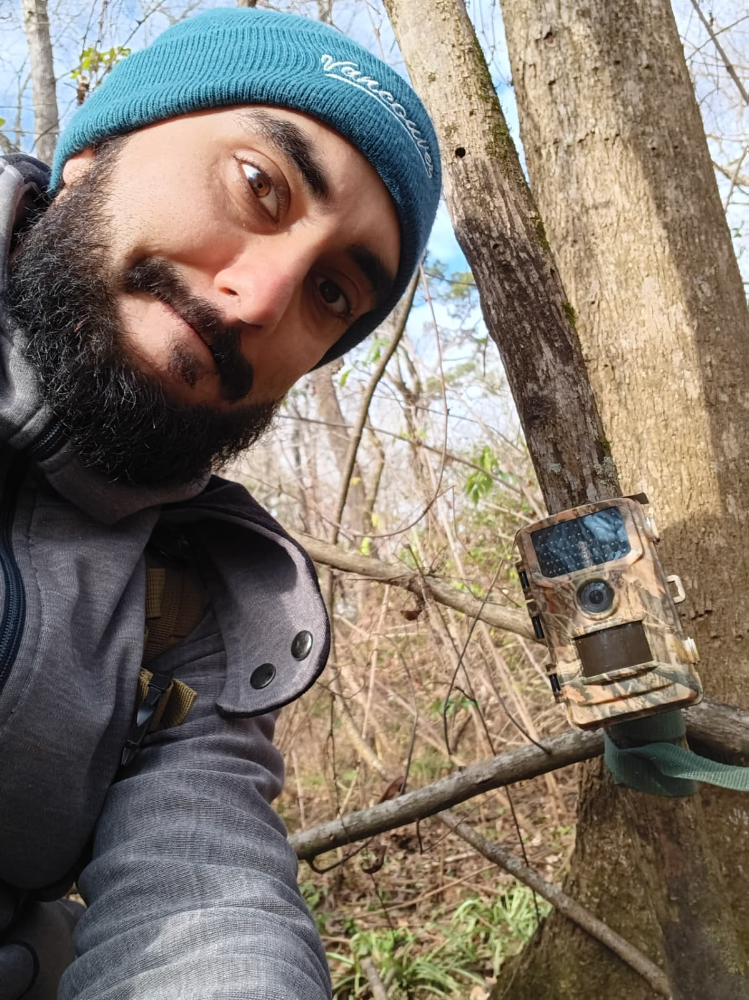

---

:::: {.home-hero}

::: {.home-intro}

<div class="home-name">Gabriel Andrade-Ponce, Ph.D.</div>

<p class="home-role">Wildlife Ecologist · Quantitative Ecologist</p>

<p class="home-position">
Postdoctoral Research Associate · Stephen F. Austin State University
</p>

<div class="home-cv">
  <a href="https://htmlpreview.github.io/?https://raw.githubusercontent.com/gpandradep/CV/master/cv.html"
     target="_blank"
     class="cv-link">
    <i class="bi bi-file-earmark-person"></i>
    Curriculum Vitae
  </a>
</div>

I am a wildlife ecologist interested in understanding how species respond to environmental variation and human-driven change. My research focuses on **terrestrial vertebrates across Latin America and the southern United States**, with particular interests in species distribution, abundance, habitat use, and ecological interactions.

I combine **field-based wildlife monitoring, hierarchical models, spatial analysis, and remote sensing** to address ecological and conservation questions across species and landscapes.

<div class="home-buttons">

[Research](research/index.qmd){.btn .btn-primary}

[Publications](publications/index.qmd){.btn .btn-outline-light}

[About me](about/index.qmd){.btn .btn-outline-light}

</div>

:::


::: {.home-photo}

<div class="profile-image-wrapper">

{fig-alt="Gabriel Andrade-Ponce" .profile-photo}

<div class="profile-links">


<a href="https://scholar.google.com.mx/citations?user=Q0_VxQsAAAAJ&hl=es"
   target="_blank"
   aria-label="Google Scholar"
   title="Google Scholar">
  <i class="ai ai-google-scholar"></i>
</a>

<a href="https://www.researchgate.net/profile/Gabriel-Andrade-Ponce"
   target="_blank"
   aria-label="ResearchGate"
   title="ResearchGate">
  <i class="ai ai-researchgate"></i>
</a>

<a href="https://orcid.org/0000-0003-2416-1792"
   target="_blank"
   aria-label="ORCID"
   title="ORCID">
  <i class="ai ai-orcid"></i>
</a>

<a href="https://github.com/gpandradep"
   target="_blank"
   aria-label="GitHub"
   title="GitHub">
  <i class="bi bi-github"></i>
</a>

<a href="mailto:gpandradep@gmail.com"
   aria-label="Email"
   title="Email">
  <i class="bi bi-envelope"></i>
</a>


</div>

</div>

:::

::::


::: {.home-section}

<div class="section-label">What I do</div>
## Research across scales, species, and landscapes

:::: {.grid}

::: {.g-col-12 .g-col-md-4 .home-card}

### Wildlife Ecology

I study how terrestrial vertebrates respond to environmental change, with interests in **distribution, abundance, habitat use, and species interactions**.

:::

::: {.g-col-12 .g-col-md-4 .home-card}

### Quantitative Ecology

I combine **hierarchical models, spatial analysis, remote sensing, and reproducible workflows in R** to address ecological and conservation questions.

:::

::: {.g-col-12 .g-col-md-4 .home-card}

### Teaching & Training

I teach **field methods, quantitative ecology, R, and study design** through university courses, workshops, and student mentoring.

:::

::::

:::

::: {.journey-section}

<div class="section-label">Academic journey</div>

## 

:::: {.journey-grid}

::: {.journey-map}

```{r}
#| echo: false
#| warning: false
#| message: false

library(leaflet)
library(sf)
library(rnaturalearth)

world <- ne_countries(
  scale = "small",
  returnclass = "sf"
)

journey <- data.frame(
  place = c(
    "Bogotá, Colombia",
    "Xalapa, Mexico",
    "Nacogdoches, Texas"
  ),
  institution = c(
    "Universidad Nacional de Colombia",
    "Instituto de Ecología A.C.",
    "Stephen F. Austin State University"
  ),
  degree= c(
    "B.Sc. in Biology",
    "M.Sc. in science & Ph.D. in science",
    "Postdoctoral Research Associate"
  ),
  lat = c(4.64, 19.54, 31.60),
  lon = c(-74.08, -96.91, -94.65)
)

journey_sf <- st_as_sf(
  journey,
  coords = c("lon", "lat"),
  crs = 4326
)

route <- st_sfc(
  st_linestring(
    as.matrix(journey[, c("lon", "lat")])
  ),
  crs = 4326
)

leaflet(
  options = leafletOptions(
    zoomControl = FALSE,
    attributionControl = FALSE
  ),
  width = "100%",
  height = 520
) |>

  addPolygons(
    data = world,
    fillColor = "#151d26",
    fillOpacity = 1,
    color = "white",
    weight = 0.6,
    opacity = 1
  ) |>

  addPolylines(
    data = route,
    color = "#8fb8a8",
    weight = 2,
    opacity = 0.8
  ) |>

  addCircleMarkers(
    data = journey_sf,
    radius = 5,
    stroke = FALSE,
    fillColor = "#8fb8a8",
    fillOpacity = 1,
    popup = ~paste0(
      "<strong>", place, "</strong><br>",
      institution,  "</strong><br>",
      degree
    )
  ) |>

  fitBounds(
    lng1 = -105,
    lat1 = 0,
    lng2 = -65,
    lat2 = 36
  )
```

:::

::: {.journey-timeline}

<div class="journey-item">

<div class="journey-year">Colombia</div>

### B.Sc. in Biology

**Universidad Nacional de Colombia**

2009 - 2015

</div>

<div class="journey-item">

<div class="journey-year">Mexico</div>

### M.Sc. in science

**Instituto de Ecología (INECOL)**

2017 - 2019

### Ph.D. in science

**Instituto de Ecología (INECOL)**

2019-2023

</div>

<div class="journey-item">

<div class="journey-year">United States</div>

### Postdoctoral Research Associate

**Stephen F. Austin State University**

2023 - present
</div>

:::

::::

:::
  
